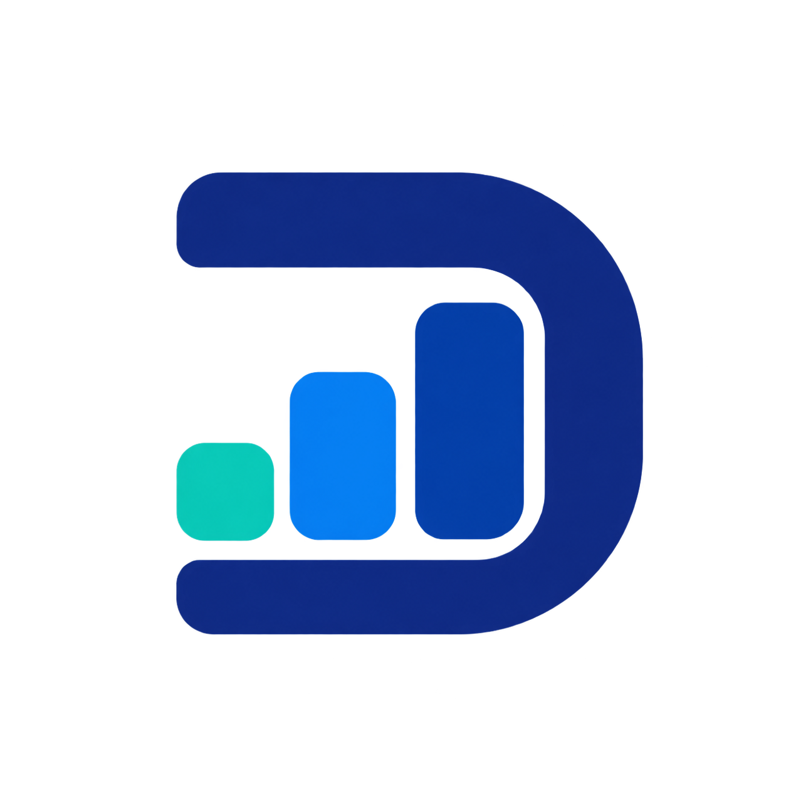
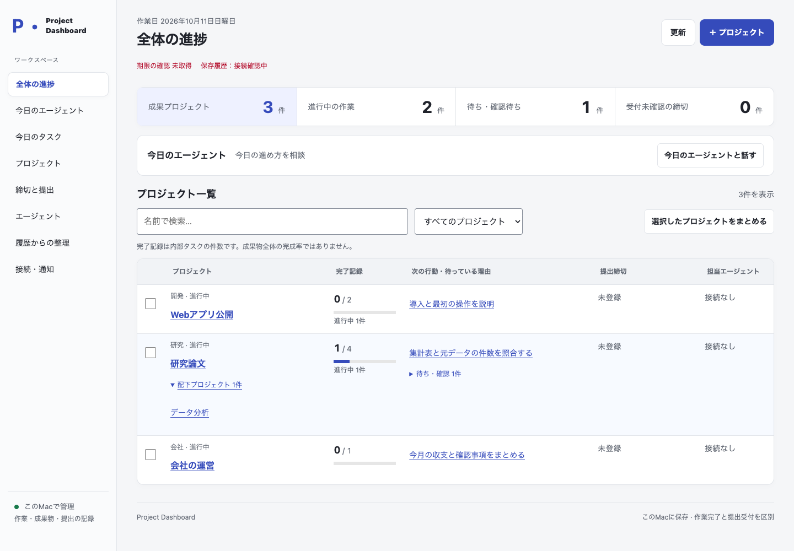
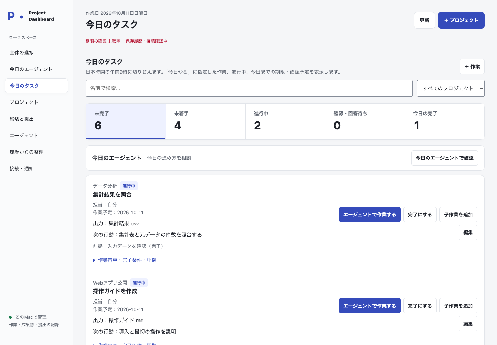
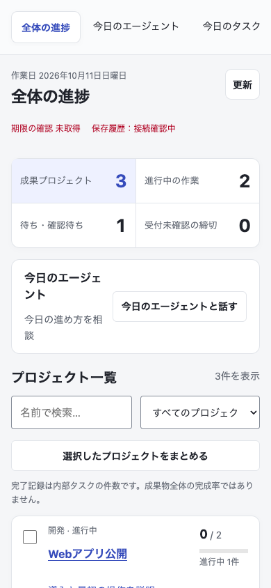

<p align="center">
  
</p>

# Project Dashboard

**Beta · v0.2.0** — 初期ベータ版として公開しています。

**成果物を持つプロジェクトと、その中のタスク・締切・提出記録を一つの画面で管理するローカルアプリ。**

論文、開発、会社の仕事を俯瞰しながら、今日進める作業と次に必要な成果物を確認できます。DSHのエージェントに作業の文脈を渡し、[Scrum](https://github.com/maas-creative/dsh-plugin-scrum)を組み合わせると担当への委譲と結果回収につなげられます。

[リリース](https://github.com/maas-creative/dsh-plugin-dashboard/releases) · [接続・実行の仕様](docs/runtime-reference.md) · [不具合報告](https://github.com/maas-creative/dsh-plugin-dashboard/issues)



*サンプルデータを使った実画面です。*

<details>
<summary>今日のタスクとスマートフォン幅の表示を見る</summary>





</details>

## できること

| 管理するもの | 使い方 |
| --- | --- |
| 成果プロジェクト | 完成形と成果物を定義し、子プロジェクトと内部タスクを階層で整理する |
| 内部タスク | 出力、依存関係、状態を記録し、着手できる作業を確認する |
| 今日の仕事 | 今日のタスクと進捗を確認し、今日のエージェントと計画を相談する |
| 締切と提出 | 締切、提出、受付の記録を管理する。作業完了とは分けて確認する |
| エージェントの作業 | 会話、実行状態、担当のモデル、成果物を確認する |
| 保存と接続 | ローカルのSQLiteに記録し、設定画面で通知・バックアップ・スマホ接続を管理する |

今日の作業日は日本時間の午前9時に切り替わります。画面から手動で次の作業日に進めることもできます。

## インストールと起動

現在の配布対象はmacOS arm64、Node.js 24以降です。DSHは固定したバージョンの依存関係としてインストールされます。エージェントを使うには、利用するモデルの認証を別途設定してください。

```sh
git clone https://github.com/maas-creative/dsh-plugin-dashboard.git
cd dsh-plugin-dashboard
npm ci
DASHBOARD_DATA="$HOME/.local/share/maas-dashboard" PORT=4318 npm start
```

表示されたローカルURLをブラウザーで開き、アプリの認証手順に従ってください。標準のURLは `http://127.0.0.1:4318/` です。ポートが使用中なら `PORT` を変更します。終了はCtrl-Cです。

`DASHBOARD_DATA` はプロジェクト・タスク・締切・提出記録と認証情報の保存先です。初回起動には個人の履歴や認証情報は含まれません。同じ保存先で起動すると記録を引き継ぎます。

## 最初のプロジェクトを作る

1. 「全体の進捗」からプロジェクトを追加し、完成形を記入します。たとえば「論文を投稿する」なら、原稿と投稿先・完了条件を整理します。
2. 内部タスクとして資料整理、分析、執筆などを追加し、それぞれの出力と依存関係を設定します。
3. 「締切と提出」に期限を登録し、「今日のタスク」で着手する作業を確認します。
4. エージェントを使う場合は「今日のエージェント」で相談し、担当の作業と成果物を確認します。
5. 成果物を確認して進捗を反映します。提出した場合は提出・受付の記録も残します。

通知の確認、担当の実行終了、タスク完了、提出受付は別の状態です。通知を確認しただけでは提出済みになりません。

## 画面の使い分け

- **全体の進捗**：プロジェクトを横断して、進捗・次の作業・締切を確認します。
- **今日のタスク**：今日取り組む作業を確認します。
- **プロジェクト**：階層と内部タスクを整理し、完了・保管・統合などを操作します。
- **今日のエージェント／エージェントの作業**：計画の相談、会話、担当の状態、成果物を確認します。
- **締切と提出**：期限と提出・受付の記録を確認します。
- **接続・通知**：モデル、認証、通知、バックアップ、スマホ接続を設定します。

スマートフォンからは同じネットワーク内で接続します。「接続・通知」で接続コードを発行し、表示されたHTTPSのURLを開いて端末の証明書設定とペアリングを行ってください。

## DSHとScrumとの関係

Project DashboardにはブラウザーUI、ローカルサーバー、DSH用の台帳読み取りプラグインが含まれます。プラグインだけをDSHホストへ組み込むこともできます。

Scrumは独立した実行プラグインです。Project Dashboardには同梱されず、Scrumを入れずにプロジェクト・タスク・締切を管理できます。Scrumを組み合わせると、委譲、結果回収、成果物確認の実行機能を利用できます。

Scrumのソースを別に取得して依存関係をインストールしたら、そのフォルダを指定して起動します。

```sh
DASHBOARD_SCRUM_PACKAGE_ROOT="/absolute/path/to/dsh-plugin-scrum" \
DASHBOARD_DATA="$HOME/.local/share/maas-dashboard" \
PORT=4318 npm run start:with-scrum
```

HardTackleの入口は `hdt` または `/hdt` です。実行の終了だけで業務タスクを完了にはせず、成果物とタスクの状態を確認します。DSHプラグインの読取範囲、ホストへの組み込み、追加のOAuth設定は[リファレンス](docs/runtime-reference.md)を参照してください。

## 開発

```sh
npm ci
npm test
DASHBOARD_SCRUM_PACKAGE_ROOT="/absolute/path/to/dsh-plugin-scrum" npm run test:resident
npm pack --dry-run
```

`test:resident` はScrumとの併用・再起動の試験です。先にScrum側でも `npm ci` を実行し、実在するフォルダを指定してください。

スクリーンショット用のサンプル画面は `npm run demo:readme` で起動できます。[画像の制作・撮影方法](docs/visual-assets.md)と[公開ソースの準備](docs/publication-guide.md)も参照してください。

## ライセンス

MaaS Creativeのオリジナルソースは **AGPL-3.0-only** です。第三者のコードには各ライセンスが適用されます。[LICENSE](LICENSE)、[NOTICE](NOTICE)、[THIRD_PARTY_NOTICES.md](THIRD_PARTY_NOTICES.md)を参照してください。
